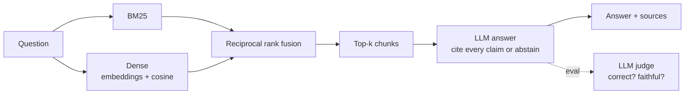

# rag-eval-lab: a RAG system you can measure

[](https://github.com/ahmedelalfiee/rag-eval-lab/actions/workflows/ci.yml)


A question-answering assistant over the **FastAPI documentation** (122 pages, ~98k words), built
to answer one question honestly: **which retrieval and generation choices actually make answers
better, and what do they cost?**

It compares lexical, dense and hybrid retrieval, two chunking strategies, top-k and models on a
**labelled evaluation set**, and scores every configuration on retrieval quality, answer
correctness, faithfulness to the sources, citation accuracy and abstention, alongside latency
and cost. CI runs an **offline quality gate**: if a change makes retrieval worse, the build fails.

## Results

### Retrieval (52 answerable questions, page-level hit)

| Retriever | Chunking | Recall@1 | Recall@3 | Recall@5 | Recall@10 | MRR |
|---|---|---:|---:|---:|---:|---:|
| BM25 | section | 0.750 | 0.808 | **0.885** | 0.962 | 0.807 |
| BM25 | fixed (200 words, 40 overlap) | 0.750 | 0.846 | 0.865 | 0.942 | 0.815 |
| Dense (`text-embedding-3-small`) | section | *run pending* | | | | |
| Hybrid (BM25 + dense, RRF) | section | *run pending* | | | | |

**Where BM25 fails is vocabulary mismatch.** Of the 6 questions it misses in the top 5, every one
is phrased differently from the docs: *"force every request to use HTTPS"* (the docs say
`HTTPSRedirectMiddleware`), *"split my endpoints across several files"* (the page is titled
*Bigger Applications*), *"hide the docs in production"* (the docs say *conditional OpenAPI*).
That is exactly the gap dense retrieval is meant to close, which the next rows measure.

### End to end (52 answerable + 8 unanswerable questions)

*Run pending.* Columns: correct %, faithful %, citation hit %, false abstentions on answerable
questions, correct abstentions on unanswerable ones, median latency, and cost per 1,000 questions.

## How it works



| Module | Responsibility |
|---|---|
| `raglab/corpus.py` | Cleans the docs (removes code-include directives, anchors, HTML) and chunks them by section or fixed windows |
| `raglab/retrieval.py` | BM25 (implemented directly), dense retrieval with an on-disk embedding cache, hybrid via RRF |
| `raglab/generate.py` | Grounded prompt, citation parsing, abstention |
| `raglab/judge.py` | Binary LLM judge for correctness and faithfulness |
| `raglab/evaluate.py` | Experiment runner; writes `results/*.csv`, `*.md` and per-question logs |
| `raglab/api.py` | `POST /ask` service returning the answer with source links |
| `eval/questions.jsonl` | The labelled evaluation set |

## Design decisions

**1. The evaluation set is built to be checkable.** Each of the 52 answerable questions has a gold
page, a reference answer and an `evidence` quote copied from that page, and a test asserts that
every quote really exists in the corpus, so the labels can't silently drift from the data.
Questions are written the way users ask, not copied from headings, so lexical retrieval doesn't
get a free pass.

**2. Unanswerable questions are part of the score.** 8 questions sound related but are not in the
docs (Celery beat schedules, Django migrations, Kubernetes autoscalers). Several share words with
real pages, so a system that always answers will look fine on accuracy and still fail here.
Abstaining correctly is measured separately from false abstentions on answerable questions.

**3. Retrieval is measured on its own before generation.** Recall@k and MRR need no LLM and no key,
so they run in CI and catch regressions in chunking or tokenisation before anyone pays for
generation.

**4. Hybrid search uses rank fusion, not score mixing.** BM25 scores and cosine similarities live
on different scales; reciprocal rank fusion combines ranks, so there is no weight to tune and
nothing to recalibrate when the corpus changes.

**5. Narrow, binary judge questions.** The judge answers two yes/no questions with a one-line
reason instead of giving a 1–10 score. Binary verdicts are easier to audit, and the reason makes
disagreements easy to inspect in the per-question logs.

**6. Cost is a first-class metric.** Every model call records tokens and latency, and each
configuration reports cost per 1,000 questions, so "better" is always weighed against "pricier".

## Run it

```bash
pip install -r requirements-dev.txt
python -m pytest -q                               # 18 tests + retrieval quality gate, no keys needed
python -m raglab.evaluate retrieval --only bm25   # offline retrieval benchmark

cp .env.example .env                              # then put your OPENAI_API_KEY in .env
python -m raglab.evaluate retrieval               # adds dense + hybrid (embeds the corpus once, < $0.01)
python -m raglab.evaluate e2e --retriever bm25 dense hybrid --model gpt-5.4-mini gpt-5.4-nano
uvicorn raglab.api:app --port 8000                # POST /ask {"question": "..."}
```

Or with Docker: `docker build -t rag-eval-lab . && docker run -p 8000:8000 --env-file .env rag-eval-lab`.

## Limitations

- **60 questions is a small set**: differences of a few points between configurations are within
  noise. It's enough to see large effects, not to rank close ones.
- **Questions were written by one person** who knows the docs, which can bias phrasing.
- **Retrieval is scored at page level**: a hit means the right page was retrieved, not necessarily
  the exact paragraph.
- **The judge is an LLM.** Its agreement with human labels should be measured on a sample before
  trusting small differences in the correctness and faithfulness columns.

## Data

`data/pages.jsonl` is a cleaned snapshot of the FastAPI documentation, used under the MIT License
(see `data/NOTICE.md`). `scripts/build_corpus.py` rebuilds it from the pinned commit.

## License

MIT
