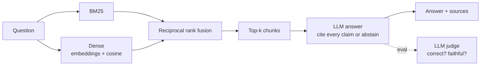

# rag-eval-lab: a RAG system you can measure

[](https://github.com/ahmedelalfiee/rag-eval-lab/actions/workflows/ci.yml)


A question-answering assistant over the **FastAPI documentation** (122 pages, ~98k words), built
to answer one question honestly: **which retrieval and generation choices actually make answers
better, and what do they cost?**

It compares lexical, dense and hybrid retrieval, two chunking strategies, top-k and models on a
**labelled evaluation set**, and scores every configuration on retrieval quality, answer
correctness, faithfulness to the sources, citation accuracy and abstention, alongside latency
and cost. CI runs an **offline quality gate**: if a change makes retrieval worse, the build fails.

## Results

**Headline:** moving from keyword search to embeddings raised correct answers from **84.6% to 94.2%**,
and the small model (**gpt-5.4-nano**) matched the larger one (**gpt-5.4-mini**) at **~30% of the cost**.
No configuration ever answered an unanswerable question.

### Retrieval (52 answerable questions, page-level hit)

| Retriever | Chunking | Recall@1 | Recall@3 | Recall@5 | Recall@10 | MRR |
|---|---|---:|---:|---:|---:|---:|
| BM25 | section | 0.750 | 0.808 | 0.885 | 0.962 | 0.807 |
| BM25 | fixed | 0.750 | 0.846 | 0.865 | 0.942 | 0.815 |
| Dense | section | 0.769 | 0.942 | **0.962** | 0.981 | 0.861 |
| Dense | fixed | 0.788 | 0.904 | 0.923 | 0.942 | 0.850 |
| Hybrid (RRF) | section | 0.769 | **0.962** | **0.962** | **1.000** | 0.865 |
| Hybrid (RRF) | fixed | **0.827** | 0.923 | **0.962** | 0.981 | **0.883** |

Dense = `text-embedding-3-small`; fixed chunks = 200 words with 40 overlap.

### End to end (52 answerable + 8 unanswerable questions, section chunks, top 5)

| Retriever | Model | Correct | Faithful | Citation hit | False abstain | Abstains when unanswerable | p50 latency | Cost / 1k questions |
|---|---|---:|---:|---:|---:|---:|---:|---:|
| BM25 | gpt-5.4-mini | 84.6% | 96.2% | 84.6% | 11.5% | 100% | 1.21 s | $1.03 |
| BM25 | gpt-5.4-nano | 84.6% | 92.3% | 86.5% | 5.8% | 100% | 1.29 s | $0.29 |
| Dense | gpt-5.4-mini | **94.2%** | 96.2% | 94.2% | 3.8% | 100% | 1.19 s | $0.95 |
| **Dense** | **gpt-5.4-nano** | **94.2%** | 96.2% | **96.2%** | **1.9%** | 100% | 1.35 s | **$0.28** |
| Hybrid | gpt-5.4-mini | 88.5% | **98.1%** | 92.3% | 3.8% | 100% | 1.20 s | $1.00 |
| Hybrid | gpt-5.4-nano | 90.4% | 94.2% | 92.3% | 1.9% | 100% | 1.38 s | $0.29 |

Generation cost only; judging is extra. Per-question answers and verdicts are in `results/runs/`.

### What the numbers say

- **Retrieval is the lever.** Every point of recall turned into answer quality: BM25's misses are
  vocabulary mismatches (*"force every request to use HTTPS"* vs `HTTPSRedirectMiddleware`,
  *"split my endpoints across several files"* vs *Bigger Applications*), and embeddings close them.
- **The bigger model bought nothing here.** With good retrieval, nano and mini tie on correctness
  while nano costs 3.4× less. The answer is in the excerpts; the model mostly has to read carefully.
- **Hybrid didn't beat dense end to end**, despite equal recall@5. The gap is 2–3 questions out
  of 52, which is within noise for a set this size. Recommended default: **dense + nano**.
- **A weaker retriever makes the model more cautious.** With BM25, mini refused 11.5% of questions
  it could have answered, because the right page often wasn't in its context.

### The judge was the weakest link (and how it was caught)

The first version of the LLM judge used one prompt that saw both the reference answer and the
retrieved excerpts. It flagged **26** answers as unfaithful. Checking those flags against the docs
showed the judge was grading faithfulness against the *reference* instead of the *excerpts*:
correct details such as `scope="request"`, `app.frontend()` and `Field(examples=...)` were all
marked "unsupported" although they are in the FastAPI docs.

**Fix:** two isolated checks. Correctness sees only the question, reference and answer;
faithfulness sees only the excerpts and the answer, and a unit test enforces that neither leaks
into the other. A `rejudge` command re-scored the saved answers without regenerating them.
Flags dropped from **26 to 14**, and faithfulness rose by 2–10 points per configuration. The v1
results are kept in `results/judge_v1/` for comparison.

## How it works



| Module | Responsibility |
|---|---|
| `raglab/corpus.py` | Cleans the docs (removes code-include directives, anchors, HTML) and chunks them by section or fixed windows |
| `raglab/retrieval.py` | BM25 (implemented directly), dense retrieval with an on-disk embedding cache, hybrid via RRF |
| `raglab/generate.py` | Grounded prompt, citation parsing, abstention |
| `raglab/judge.py` | Two isolated binary LLM checks: correctness and faithfulness |
| `raglab/evaluate.py` | Experiment runner; writes `results/*.csv`, `*.md` and per-question logs |
| `raglab/api.py` | `POST /ask` service returning the answer with source links |
| `eval/questions.jsonl` | The labelled evaluation set |

## Design decisions

**1. The evaluation set is built to be checkable.** Each of the 52 answerable questions has a gold
page, a reference answer and an `evidence` quote copied from that page, and a test asserts that
every quote really exists in the corpus, so the labels can't silently drift from the data.
Questions are written the way users ask, not copied from headings, so lexical retrieval doesn't
get a free pass.

**2. Unanswerable questions are part of the score.** 8 questions sound related but are not in the
docs (Celery beat schedules, Django migrations, Kubernetes autoscalers). Several share words with
real pages, so a system that always answers will look fine on accuracy and still fail here.
Abstaining correctly is measured separately from false abstentions on answerable questions.

**3. Retrieval is measured on its own before generation.** Recall@k and MRR need no LLM and no key,
so they run in CI and catch regressions in chunking or tokenisation before anyone pays for
generation.

**4. Hybrid search uses rank fusion, not score mixing.** BM25 scores and cosine similarities live
on different scales; reciprocal rank fusion combines ranks, so there is no weight to tune and
nothing to recalibrate when the corpus changes.

**5. Narrow, binary, isolated judge checks.** Each check answers one yes/no question with a
one-line reason, and sees only the inputs it needs. Binary verdicts are easier to audit, and the
reasons are what made the v1 judge's error visible in the per-question logs.

**6. Cost is a first-class metric.** Every model call records tokens and latency, and each
configuration reports cost per 1,000 questions, so "better" is always weighed against "pricier".

## Run it

```bash
pip install -r requirements-dev.txt
python -m pytest -q                               # 19 tests + retrieval quality gate, no keys needed
python -m raglab.evaluate retrieval --only bm25   # offline retrieval benchmark

cp .env.example .env                              # then put your OPENAI_API_KEY in .env
python -m raglab.evaluate retrieval               # adds dense + hybrid (embeds the corpus once, < $0.01)
python -m raglab.evaluate e2e --retriever bm25 dense hybrid --model gpt-5.4-mini gpt-5.4-nano
python -m raglab.evaluate rejudge                 # re-score saved answers with the current judge
uvicorn raglab.api:app --port 8000                # POST /ask {"question": "..."}
```

Or with Docker: `docker build -t rag-eval-lab . && docker run -p 8000:8000 --env-file .env rag-eval-lab`.

## Limitations

- **60 questions is a small set**: differences of a few points between configurations are within
  noise. It's enough to see large effects, not to rank close ones.
- **Questions were written by one person** who knows the docs, which can bias phrasing.
- **Retrieval is scored at page level**: a hit means the right page was retrieved, not necessarily
  the exact paragraph.
- **The judge is an LLM.** v2 fixed a systematic error, but the remaining 14 faithfulness flags
  have not been human-verified (some claims are true in general but may not be in the retrieved
  excerpts). A human-labelled agreement sample is the next step before trusting small differences.
- **One run per configuration** and LLM outputs are not deterministic, so ±2–3 points between
  rows should not be over-read.

## Data

`data/pages.jsonl` is a cleaned snapshot of the FastAPI documentation, used under the MIT License
(see `data/NOTICE.md`). `scripts/build_corpus.py` rebuilds it from the pinned commit.

## License

MIT
